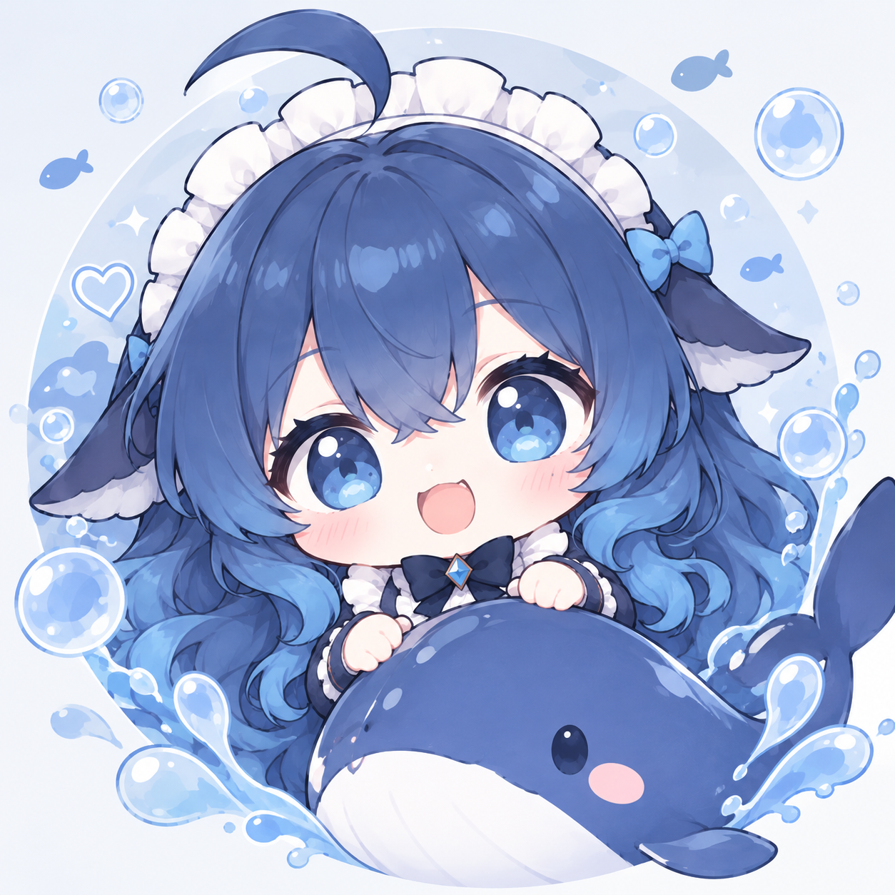

<p align="center">
  
</p>

<h1 align="center">大肥鱼 · Big Fat Fish</h1>

<p align="center">会聊天、会看图、会画画，也会认真记住你说的话。咕噜。</p>

<p align="center">
  <a href="docs/usage.md">和本鱼玩</a> ·
  <a href="docs/napcat-deployment.md">接本鱼回家</a> ·
  <a href="docs/README.md">翻翻说明书</a> ·
  <a href="CHANGELOG.md">成长记录</a>
</p>

你好呀，本鱼是大肥鱼，住在 QQ 群和私聊里的吉祥物。喜欢火锅和奶茶，偶尔反应慢半拍，不过你认真说话的时候，本鱼也会认真听。

本鱼有一颗用 **Node.js 自己写的脑袋**，通过 OneBot 11 协议和 NapCat 对话，由 NapCat 帮本鱼接入 QQ。接上模型就能开聊；人设、记忆和图片都存在你自己的本地目录里，还有一个网页工作台可以照顾本鱼。

## 本鱼会些什么

| 本鱼的本领 | 怎么玩 |
| --- | --- |
| **聊天与戳一戳** | 私聊直接说；群里 @、喊名字、引用本鱼的回复，或戳一戳。支持上下文、分段回复、引用和可调节奏。[聊天说明](docs/usage.md) |
| **看图接话** | 看本条图片，也能接着聊你刚发的图；私聊支持只发图片，每轮最多看一张。[看图说明](docs/usage.md#看图与画画) |
| **帮你画画** | 说“画一只戴围巾的猫”，或用 `/draw`。开始画时会打招呼，生成的原图自动归档。[绘图与存储](docs/media-storage.md) |
| **收藏和发表情** | 附图或引用表情教本鱼收藏，再按意思查找、发送；支持 GIF、QQ 商城和内置表情，也能改名、停用。[表情手册](docs/memes.md) |
| **人设与长期记忆** | 每个群、每段私聊分别保存；可以直接教本鱼，也会后台整理记忆。群聊长时间无人调用后暂停提炼。[记忆说明](docs/usage.md#人设与记忆) |
| **调整本鱼的说话方式** | Prompt 工作台提供编辑、请求预览、会话快照测试、人工评审、发布和版本回退。[Prompt 工作台](docs/prompt-console.md) |
| **照看本鱼的日常** | 网页查看连接、事件、日志和模型用量；调整行为、QQ 权限、功能开关、每日额度及后台任务。[管理工作台](docs/management.md) |
| **翻翻本鱼的收藏** | 分别浏览绘图作品和表情收藏，搜索、按会话筛选、查看详情、下载本地原图。[素材浏览](docs/management.md#页面与行为) |

这些本领受配置、权限和额度控制。自然语言操作还要看模型是否理解到位；想明确下指令，可以翻 [指令速查](docs/usage.md#指令速查)。

## 先跟本鱼打个招呼

```text
@大肥鱼 今天过得怎么样？
@大肥鱼 帮我画一只抱着奶茶的蓝色小鱼
@大肥鱼 /remember 小明不吃香菜
@大肥鱼 /meme help
```

群里的 `@大肥鱼` 要用 QQ 真正的 @。私聊直接发送正文或指令就好；群聊斜杠指令需要 @，喊名字不能替代。

## 接本鱼回家

准备好 Docker Compose、一个用于登录的 QQ 账号和模型接口配置。在项目根目录执行（已有配置请保留）：

```sh
cp -n .env.example .env
cp -n config.example.json config.json
```

在 `.env` 填好 `NAPCAT_ACCOUNT`、`ONEBOT_ACCESS_TOKEN` 和聊天模型的 `DEEPSEEK_API_KEY`、`DEEPSEEK_BASE_URL`、`DEEPSEEK_MODEL`。想让本鱼画画，再配置 `IMAGE_API_*` / `IMAGE_MODEL`；想打开工作台，设置至少 24 字符的随机 `ADMIN_TOKEN`。

```sh
docker compose up -d --build
```

打开 [NapCat 登录页](http://localhost:6099/webui) 完成 QQ 登录，再到 [肥鱼工作台](http://127.0.0.1:3210) 输入 `ADMIN_TOKEN`。完整步骤、宿主机开发和重启说明见 [部署文档](docs/napcat-deployment.md)。

## 本鱼也有不会的

语音、视频、文件和好友／入群申请目前只收件，不自动理解或批准；后台任务用于记忆提炼与数据清理，还没有定时主动发 QQ 消息。接收全部 OneBot 标准事件，不等于每种内容都会处理，具体见 [接收边界](docs/onebot-reception.md)。

想改代码，看 [架构与开发](docs/architecture.md)；想改默认人设，看 [Prompt 文件](prompts/README.md)；其他细节都收在 [文档目录](docs/README.md)。

本鱼的记性靠文件，长肉靠奶茶。请照顾好 `data/`，谢谢你啦。
