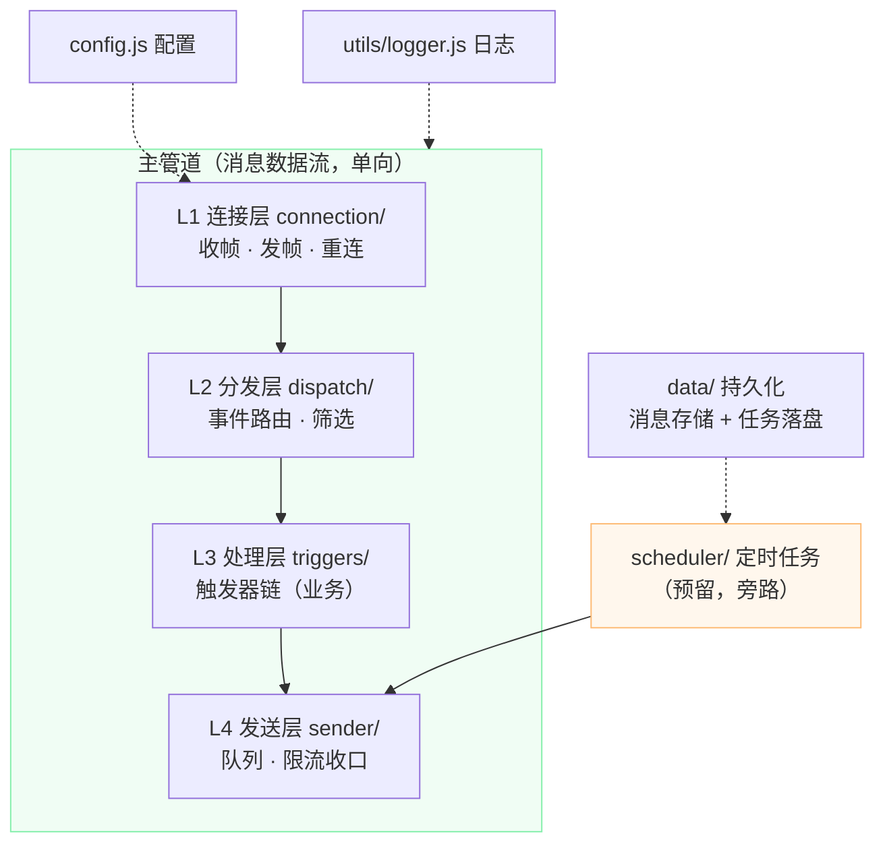
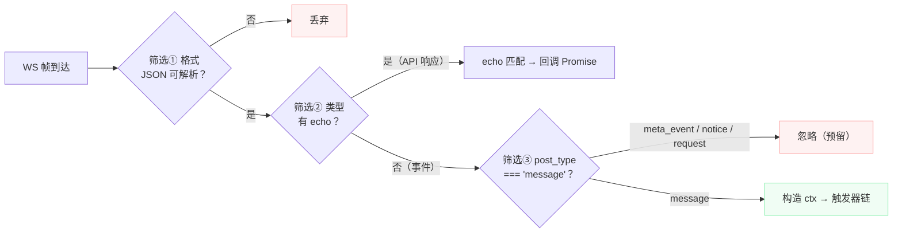
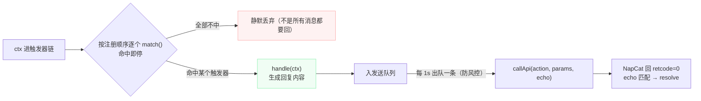
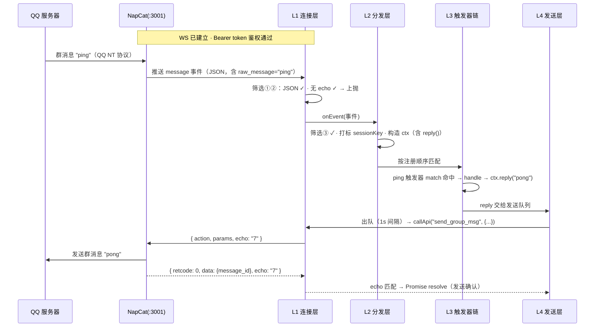
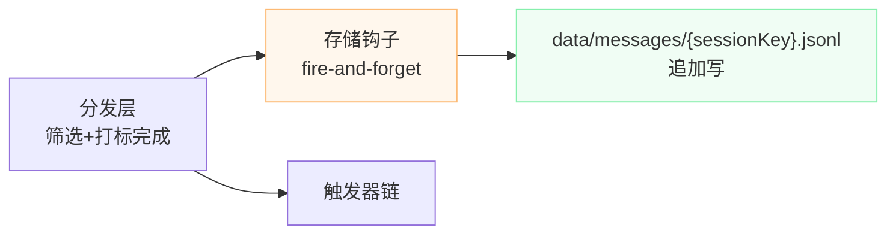

# Bot 核心设计：分层、模块与消息流

> 版本：v0.2 · 2026-10-24（新增：分发打标 sessionKey、消息存储设计）
> 定位：讲清 Bot 核心的模块划分、分层职责与**一条消息的完整流通路径**。
> 姊妹文档：[qq-chatbot-architecture.md](./qq-chatbot-architecture.md)（项目方向与边界），本文不重复。

---

## 1. 总览：分层管道 + 横切组件

核心思想一句话：**入站一串筛选，出站一个收口，中间才轮到业务**。



读图要点：

- **主管道四层**：数据只能从上往下流，禁止跨层乱穿（L3 不 import L1，只通过 `ctx.reply()` 把消息交给 L4）；
- **定时任务是旁路**：它没有"收到消息"这个起点，直接把生成好的消息插进发送层——这就是发送层必须是全项目唯一出口的原因；
- **横切组件**（配置/日志/持久化）不属于任何一层，被所有层共享，用虚线表示。

---

## 2. 消息怎么流（核心节）

### 2.1 入站：三层筛选

每一帧从 WS 到达后，要过三道门，任何一道不过就直接丢弃，到不了业务代码：



| 筛选 | 在哪层 | 作用 |
|---|---|---|
| ① JSON 可解析 | L1 | 挡掉坏帧/非 JSON 数据 |
| ② 有 `echo` 字段 | L1 | 区分"API 响应"和"事件"——两者走同一条 WS，全靠 echo 区分 |
| ③ `post_type === 'message'` | L2 | MVP 只处理消息事件；心跳/戳一戳/加群请求全部拦下 |

**筛选的意义**：业务代码（触发器）看到的事件都是"干净的、确定是聊天消息"的数据，不需要自己判断乱七八糟的情况。

### 2.2 生成与出站：命中即处理

过了三道门的消息，在分发层还有一步**打标**：计算会话键并挂到 `ctx.sessionKey`（群聊 `g-{group_id}`、私聊 `p-{user_id}`）。同一个 sessionKey 的消息属于同一场对话——冷却计数、上下文记忆、消息存储都以它为索引，下游谁都不用自己拼。打完标的消息进入触发器链，匹配成功就生成回复，然后统一出站：



出站为什么收口到一个队列：**QQ 对发消息的频率有限制**，全项目不管几个模块要发消息，都排同一条队、按固定间隔出门，风控风险只在这一个点管理。

### 2.3 完整生命周期：一条 ping 的旅行

以群聊里发 `ping` 为例，从 QQ 到回复的全链路：



三个容易忽略的细节：

1. **`ctx.reply()` 不是立即发送**，只是入队——真正的发送由队列节奏决定；
2. **API 调用是异步的**：发出去只是"提交"，收到 `retcode=0` 那条响应才算"确认"；
3. **响应和事件走同一条 WS**：N-->>C 的那条响应靠 `echo: "7"` 找到对应的 Promise，这就是 echo 匹配机制。

---

## 3. 分层职责速查

| 层 | 目录 | 职责一句话 | 关键决策 | 禁止事项 |
|---|---|---|---|---|
| L1 连接 | `src/connection/` | 字节与协议：收帧、发帧、重连、echo 匹配 | 正向 WS + Bearer 鉴权 + 15s 调用超时 | 出现任何业务词汇 |
| L2 分发 | `src/dispatch/` | 筛选 → 打标 → 派发 | MVP 只放行 message；打标 sessionKey 后进触发器 | 写业务 if-else |
| L3 处理 | `src/triggers/` | 触发器链：一条消息触发什么回复 | 注册式、按序匹配、命中即停 | 触发器之间互相调用 |
| L4 发送 | `src/sender/` | 出站收口：队列 + 限流 | 固定 1s 间隔 | 提供绕过队列的接口 |

---

## 4. 处理层怎么组织（带过）

触发器契约：`{ name, match(event) → boolean, handle(ctx) }`

- **加功能 = 加文件 + index.js 一行注册**，分发器永不修改；
- **按注册顺序匹配，命中即停**：一条消息只触发一个回复，避免刷屏；
- MVP 的"类 Chat"行为完全够用：关键词/命令 → 固定或拼接回复（`ping → pong` 即首个实例）；
- 将来接 LLM：LLM 调用塞进某个触发器的 `handle` 内部，架构不变（呼应架构文档第 9 节）。

---

## 5. 通用组件（横切）

| 组件 | 位置 | 状态 | 说明 |
|---|---|---|---|
| 配置 | `src/config.js` | ✅ | env 优先 + 默认值，全项目唯一配置来源 |
| 日志 | `src/utils/logger.js` | ✅ | 统一格式 `[时间] LEVEL 消息` |
| 发送队列 | `src/sender/sender.js` | ✅ | 1s 固定间隔，全项目唯一出站口 |
| 持久化 | `data/` | 设计已定（§6） | 消息 JSONL 先行；定时任务落盘随后 |
| 权限 | 未建 | 预留 | 管理员命令需要，一个 QQ 号白名单即可 |
| 调度器 | `scheduler/` | 预留 | 旁路直插发送层，见第 1 节 |

---

## 6. 消息存储设计

### 6.1 背景：为什么必须自己存

- OneBot 11 正向 WS **只推实时事件，不补发**：断线/重启期间的消息不会重推，连接前的历史更不会回放；
- NapCat 不维护可靠的消息库：`get_group_msg_history` 等拉取 API 查的是 QQNT 本地缓存，掉线期间会缺，且不是为分析设计的形状；
- 结论：**消息流过分发层时自己落一份**，这是唯一可靠的历史来源。

### 6.2 设计决策

| 决策点 | 结论 | 理由 |
|---|---|---|
| 挂载点 | 分发层出口（打标后的 ctx 快照），不存原始帧 | 存"洗干净 + 带 sessionKey"的形状，业务与 LLM 直接可用 |
| 存的范围 | 仅 message 事件 | 心跳/notice 对历史无价值，需要时再扩 |
| 文件粒度 | 按会话分文件：`data/messages/{sessionKey}.jsonl` | sessionKey 即文件名；单会话重放/喂上下文只读一个文件 |
| 格式 | JSONL 追加写（append-only） | 零依赖、可 grep、可重放；查询复杂了再迁 SQLite，届时写转换脚本 |
| 定时任务 | `data/jobs.json` 单文件全量读写 | 任务量级小（几十条），改一条写一次；原子写（写临时文件 + rename）防半截文件 |

**最终选型（已拍板）**：消息与任务均先用 JSON 文件，出现跨会话查询/统计需求时再迁移 SQLite（嵌入式，非服务器型）。

存储条目 = ctx 快照，一条一行：

```json
{ "sessionKey": "g-741883823", "time": 1760000000, "message_id": -114514,
  "message_type": "group", "group_id": 741883823, "user_id": 2434546640,
  "raw_message": "ping", "sender": { "nickname": "天子", "card": "", "role": "member" } }
```

### 6.3 两条纪律（比位置更重要）

1. **旁听者模式**：dispatcher 派发前把 ctx 快照丢给存储钩子即返回，落盘失败/变慢不影响主管道与回复（fire-and-forget）；
2. **出站回复不回存**：MVP 只记录入站消息；将来 LLM 需要完整对话上下文时，再把 `reply()` 的内容一并落盘。



---

## 7. MVP 范围与现状

| 项 | 状态 |
|---|---|
| L1 连接层（鉴权/重连/echo） | ✅ 已实现 |
| L2 分发层（message 筛选 + ctx） | ✅ 已实现 |
| L3 触发器链 + ping | ✅ 已实现（闭环验证进行中） |
| L4 发送层（队列限流） | ✅ 已实现 |
| 心跳监控 / 事件去重 | ⏸ 遇到问题再补（保险丝项） |
| sessionKey 打标 + 消息存储 | ⏭ 已定设计（§6），待实现 |
| 调度器 / 权限 | 下一期 |

MVP 验收标准就一条：**群里发 `ping`，机器人回 `pong`，日志里能看到完整流通路径**。
