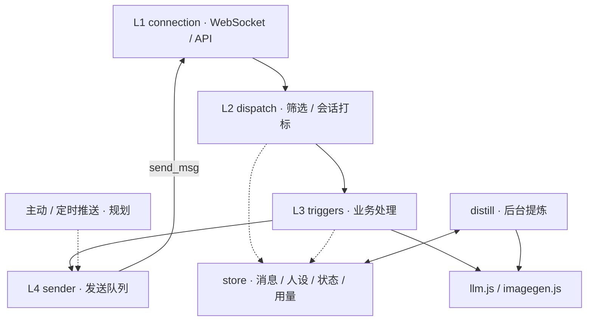
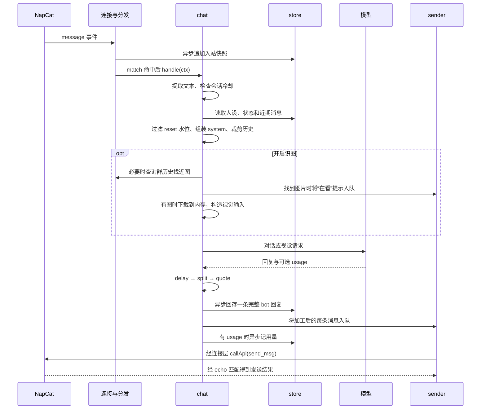

# Bot 核心设计：分层、模块与消息流

> 文档版本：v0.3 · 2026-10-26；实现基线：`c167cca`（`0.11.0`）。
> 定位：描述当前模块职责、消息流和存储语义。项目目标与下一阶段范围见 [架构文档](qq-chatbot-architecture.md)。本文中的默认值以 [config.js](src/config.js) 为准。

## 1. 总览：消息管道与后台提炼

主管道处理收到的消息；后台提炼器从存储读取对话并更新人设、记忆，不主动发消息。规划中的推送任务将复用发送层，当前尚未实现。

配置、日志和存储是共享组件。发消息统一经过 sender；当前识图查询近图时由 chat 直接调用连接层的历史 API，属于现有的辅助读取路径。

## 2. 消息怎么流

### 2.1 入站：解析、响应匹配与事件筛选

1. 连接层解析 WebSocket 帧，无法解析的 JSON 直接忽略。
2. 帧中 `echo` 能匹配待处理 API 调用时，按 `retcode` 完成或拒绝对应 Promise；其余带 `post_type` 的帧上抛给分发器。
3. 分发器目前只接受 `post_type === 'message'`；`notice`、`request`、`meta_event` 不进入触发器。
4. 群聊使用 `g-{group_id}`，私聊使用 `p-{user_id}` 作为 `sessionKey`；入站消息快照异步回存后进入触发器链。

`sessionKey` 是上下文、冷却、人设、状态与用量的索引。一个群共享一份会话，不按群内用户拆分记忆。

### 2.2 触发与出站

注册顺序由 [index.js](src/index.js) 决定：

| 顺序 | 触发器 | 行为与门控 |
|---|---|---|
| 1 | `ping` | `raw_message.trim()` 等于 `ping` 时回复 `pong`，不要求群聊 @ |
| 2 | `draw` | 配置绘图 Key 后匹配 `/draw`；群聊须 @；群聊／私聊均校验绘图白名单 |
| 3 | `command` | 匹配所有 `/` 前缀文本；群聊须 @ 后才执行或回应；按具体指令校验权限 |
| 4 | `chat` | 配置聊天 Key 后，私聊进入处理；群聊由 @、名字、引用三个条件组合判定 |

匹配成功后只执行该触发器，返回时不会继续尝试后面的触发器。因此群聊未 @ 的斜杠指令会被 command 静默接住，不落入 chat。命中一个触发器可以产生多条回复，例如聊天拆段、绘图的过渡提示与图片。

所有消息最终入 sender 队列，统一调用 `send_msg`，通过参数区分群聊与私聊。每次 API 调用结束后等待 `SEND_INTERVAL_MS`（默认 1000ms），再处理下一条；单条失败记 WARN 并继续，当前不自动重试。

### 2.3 一条聊天消息的完整路径

需要区分“入队”和“送达”：`ctx.reply()` 及 `sendGroup()`／`sendPrivate()` 不返回发送确认 Promise，`await ctx.reply()` 也不表示 NapCat 已确认。sender 在 `retcode=0` 后记录消息 ID，用于后续引用触发。

## 3. 分层职责速查

| 层 | 位置 | 当前职责 |
|---|---|---|
| L1 连接 | `src/connection/onebot.js` | 正向 WS、可选 Bearer 头、事件上抛、echo 匹配；默认重连 5s、API 超时 15s |
| L2 分发 | `src/dispatch/` | message 筛选、sessionKey、入站快照、构造 ctx、按注册表派发与异常日志 |
| L3 处理 | `src/triggers/` | 指令、聊天、绘图；群聊条件组合、上下文与回复加工 |
| L4 发送 | `src/sender/` | 全局 FIFO 队列、默认 1s 间隔；记录最近 1000 个发送成功的机器人消息 ID |

连接层不含业务，分发器不按具体业务名称写分支，触发器不互相调用。所有出站消息都必须经过 sender。限流控制发送节奏，不保证平台一定接受消息。

## 4. 处理层与扩展点

触发器契约：`{ name, match(event) → boolean, handle(ctx) }`。新增同类消息业务通常是新增文件并在入口注册；新增事件类型还需要调整分发器的放行范围与 ctx 契约。

### 4.1 聊天

- `chat-conditions.js`：群聊 @、名字呼唤、引用机器人消息，任一启用条件命中即可。引用 ID 仅保存在进程内，重启后清空。
- `chat.js`：无文本时返回；按会话冷却（默认 5s），读取近期消息（默认 20 条），过滤当前消息和 `/reset` 水位之前的历史，再调用模型。
- `chat-system.js`：人设、记忆、群聊／私聊规则组成固定前缀；当前时间、场景与静默时长放在尾部。
- `chat-context.js`：用默认 12000 字节预算扣除 system 后保留最近连续历史；它只裁剪历史，不截断 system，也不把当前输入和图片字节计入，因此不是整个请求的硬上限。
- `chat-reply-chain.js`：默认延迟 2–8s，按换行／配置分隔符拆段，群聊首条挂引用。存储保留一次模型输出全文，发送可以拆成多条。

识图在完成文本与冷却检查后执行：优先当前消息第一张可用图，否则从群聊最近 20 条消息找同用户、默认 120s 时间窗内的近图。只取一张，私聊不查历史。下载失败或视觉调用失败回退纯文本；图片本体只在内存中使用，不写入消息库。

### 4.2 指令与绘图

`command.js` 的 `COMMANDS` 注册表包含名称、权限、说明和处理函数，`/help` 从该表生成。当前普通指令包括 help、status、persona 查看、memory、remember、character、version；群聊的 reset、history、persona reset 需 `ADMIN_QQ` 白名单，私聊放行。

`/remember` 和 `/character` 不调用模型，直接写入当前会话的记忆／人设。`/reset` 仅重置聊天历史可见水位；`/persona reset` 恢复种子人设并清空记忆，两者作用不同。

draw 是独立触发器，排在 command 前，不在 `COMMANDS` 表内，因此当前 `/help` 不自动列出 `/draw`。绘图 Key 与 `DRAW_WHITELIST_QQ` 分别控制启用与使用权限；结果经 sender 发送，历史仅保存 `[图片] prompt` 占位文本。

### 4.3 后台提炼

配置聊天 Key 时启动提炼器，默认每 60s 扫描一次会话；有未处理消息且静默达到 10 分钟或新增达到 50 条时调用模型。每轮每会话取水位后最近最多 100 条记录。

模型返回完整 character／memory 文件内容，经形状校验、锁定条目校验和容量处理后写入；至少一个文件写成功便推进 `distillMark`。连续两次全失败后退避一小时。同一会话提炼有防重入保护。

“离线提炼”表示脱离实时回复主流程，仍会调用远程模型并消耗用量。扫描范围是消息文件中的会话，不仅是曾经触发 chat 的会话。

## 5. 通用组件

| 组件 | 位置 | 说明 |
|---|---|---|
| 配置 | `src/config.js` | 环境变量与默认值；启动时读取并合并 `config.json`，没有热加载 |
| 日志 | `src/utils/logger.js` | 统一 INFO／WARN／ERROR 输出 |
| 模型请求 | `src/llm.js`、`src/imagegen.js` | 对话／视觉与绘图的 HTTP 请求入口，超时与异常由调用方处理 |
| 消息存储 | `src/store/message-store.js` | 按会话 JSONL 追加，读历史时全读文件再筛选 |
| 人设存储 | `src/store/persona-store.js` | 种子、显式教学、模型补丁、重置与审计 |
| 会话状态 | `src/store/session-state.js` | reset／distill 水位与提炼失败状态 |
| 用量存储 | `src/store/usage-store.js` | 部分成功聊天／提炼路径的 usage，按会话汇总；未覆盖绘图等全部调用 |
| 版本展示 | `src/version.js` | 读取 CHANGELOG 第一条版本标题；不读取 package.json |

## 6. 存储设计与语义

### 6.1 保存范围

Bot 自行保存经过分发器的实时消息和准备发送的回复，用于后续上下文与提炼。目前没有断线历史补录流程；近图查询也不会把整段 NapCat 历史补入消息库。

### 6.2 文件形状

默认路径如下，`DATA_DIR`、`PERSONA_DIR`、`USAGE_DIR` 可以分别覆盖：

| 内容 | 默认位置 | 写入方式 |
|---|---|---|
| 消息 | `data/messages/{sessionKey}.jsonl` | 入站快照与 `bot: true` 出站行追加 |
| 会话状态 | `data/session-state/{sessionKey}.json` | 读、合并、整文件写回 |
| 人设／记忆 | `data/personas/{sessionKey}/character.md`、`memory.md` | 显式追加、提炼替换、指令重置 |
| 人设审计 | `data/personas/{sessionKey}/history.jsonl` | 变动记录追加 |
| 用量 | `data/usage/{sessionKey}.jsonl` | 返回的 usage 追加 |

入站保存文本、时间、消息 ID、发送者等快照，不保存完整消息段数组。出站 bot 行没有发送后的消息 ID。消息时间、`resetAt`、`distillMark` 使用秒；用量与审计时间使用毫秒。

当前没有任务文件或 `data/jobs.json`。任务持久化方案随主动／定时功能业务一起确定。

### 6.3 写入与失败语义

1. 入站消息、出站回存和用量使用异步追加，失败记 WARN；各存储模块通过自己的 Promise 链串行写入，减少并发覆盖和错序。
2. 出站在 API 确认前回存。消息库记录“准备回复的内容”，不能当作送达账本；发送失败后没有对应的状态回写。
3. 状态与人设目前直接整文件写回，没有临时文件 rename 或跨文件事务；串行化不等于异常退出时的原子落盘。
4. 显式教学追加超限时会淘汰较旧的教学行，并保留最新行，因此 4096 字节不是所有写入路径的硬上限。模型补丁中 character 超限拒绝该文件；memory 超限先裁非锁定行，仍超限则拒绝。
5. 提炼校验要求保留本轮读取到的 `/remember` 与 `/character` 锁定条目；核心性格的延续由提示词要求。这里不承诺所有并发场景下的冲突保护或模型对核心性格的绝对遵从。

## 7. 当前实现与验证边界

消息接入、分发、统一发送、AI 对话、多模态、指令权限、消息存储、人设提炼与基础用量记录均已有实现。通用主动／定时推送、更多事件类型、管理 API／面板与完整用量管理尚未实现。

2026-10-26 在代码基线 `c167cca` 上运行模拟测试：232 项，231 通过、1 失败。失败来自 `test/persona-store.test.js` 引用了未随仓库交付的 `.trae/specs/add-self-evolving-persona/spec.md`；本轮仅记录，未修复测试。

该结果验证本地模拟协议与代码行为，不等价于真实 QQ／模型或长期运行验收。发送队列持久化、心跳存活检测、事件去重和停机排空尚未实现；是否补齐按运行中出现的问题与阶段验收需要决定。
