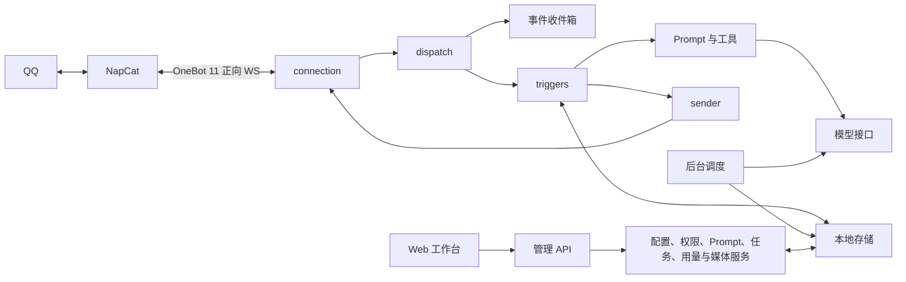

# 架构与开发

[← 文档目录](README.md)

按 2026-10-29 工作区实现整理。这里说明当前模块与数据流；运行契约见 [管理文档](management.md)，早期设计保留在 [历史归档](README.md#历史归档)。

## 组成与消息流

NapCat 负责 QQ 登录和协议接入，Bot 通过 OneBot 11 正向 WebSocket 主动连接它。Bot 使用 Node.js ESM，运行依赖为 `ws` 与 `proper-lockfile`；工作台由同一进程提供 HTTP API 和原生 HTML/CSS/JavaScript 静态页面。



1. 连接层解析消息帧，按 `echo` 匹配 API 结果，把事件交给分发器；断线后重连。
2. 分发器先保存事件，再判断消息段、QQ 角色与业务资格。群聊使用 `g-{group_id}`，私聊使用 `p-{user_id}` 作为会话键。
3. 入口依次注册 `poke → ping → draw → meme → command → chat`，匹配即停；触发器继续检查自身开关、权限、唤醒和冷却条件。
4. 聊天捕获已发布的 Prompt 版本，组装当前输入、人设、记忆与筛选后的历史，必要时附图。模型工具可绘图、读写记忆、收藏／查找／发送表情，参数与作用范围由后端校验。
5. 所有 QQ 出站消息经过 sender 的统一队列。普通聊天可延迟、分段和引用；戳一戳只发一句短回复。模型 SSE 流在服务端合并，QQ 不逐 token 发送。
6. 后台调度运行记忆提炼与观察数据清理。群聊提炼遵守活跃窗口与休眠规则，目前没有主动发 QQ 消息的任务类型。

具体接收边界见 [OneBot 接收契约](onebot-reception.md)；当前使用 `send_msg`、`get_group_msg_history` 和 `get_msg`，详见 [协议参考](napcat-protocol.md#46-本项目-api-使用记录)。

## 代码放在哪里

| 位置 | 职责 |
| --- | --- |
| [`src/index.js`](../src/index.js) | 服务装配、触发器注册、连接启动与停机 |
| [`src/connection/`](../src/connection/)、[`src/protocol/`](../src/protocol/)、[`src/dispatch/`](../src/dispatch/) | WS 与 API、事件归一化、会话与触发器分发 |
| [`src/triggers/`](../src/triggers/)、[`src/sender/`](../src/sender/) | 业务触发、回复加工与统一发送 |
| [`src/prompt/`](../src/prompt/)、[`prompts/`](../prompts/README.md) | Prompt 加载、版本、组装、测试、trace 与默认正文 |
| [`src/tools/`](../src/tools/)、[`src/memes/`](../src/memes/) | 模型工具、图片投递、会话表情收藏与检索 |
| [`src/llm.js`](../src/llm.js)、[`src/imagegen.js`](../src/imagegen.js) | 对话／视觉／提炼及图片生成请求 |
| [`src/distill/`](../src/distill/) | 记忆提炼、校验、失败退避与群聊活跃窗口 |
| [`src/platform/`](../src/platform/) | 运行锁、配置、权限、持久化、调度及用量策略 |
| [`src/store/`](../src/store/) | 消息、事件、人设、会话状态、用量和媒体存储 |
| [`src/admin/`](../src/admin/)、[`web/`](../web/) | 管理 API、素材读取服务和网页工作台 |
| [`scripts/`](../scripts/)、[`test/`](../test/) | NapCat 初始化、隔离浏览器检查与自动化测试 |

## 配置与数据

| 入口 | 生效方式 |
| --- | --- |
| [`.env.example`](../.env.example) → `.env` | 连接、密钥、模型、路径和端口，启动时读取；已有进程环境变量优先 |
| [`config.example.json`](../config.example.json) → `config.json` | 行为初值，启动时合并默认配置 |
| 工作台配置中心 | 保存并校验后对后续请求生效，优先于行为初值 |
| Prompt 工作台 | 草稿经测试和评审后发布；新请求使用新版本，初始人设仅影响新建／重置会话 |
| [`prompts/`](../prompts/README.md) | 仓库默认模板，重启后加载；不覆盖已有发布配置和会话人设 |

默认运行数据都在 `data/`，采用 JSON、JSONL、Markdown 和媒体原文件，无数据库服务。`PERSONA_DIR`、`USAGE_DIR` 可独立覆盖路径。`napcat/QQ` 与 `napcat/config` 保存 QQ 登录数据和接入配置。备份前停止 Bot，并核对所有自定义目录；不要只备份人设而遗漏用量、配置或媒体索引。

同一数据目录只允许一个 Bot 进程。关键文件采用原子替换，但没有跨文件事务；发送队列保存在内存，聊天历史中的 bot 行也不代表 QQ 已送达。每日请求上限包含失败及并发预留，token 限制依据已报告用量，不等于金额或硬性消费上限。更多持久化和停机语义见 [管理文档](management.md)。

## 本地开发与验证

使用 Node.js 22.9+。先按 [部署文档](napcat-deployment.md) 配置 NapCat 与 `.env`，停止使用同一数据目录的容器 Bot，再运行：

```sh
npm ci
npm run dev
```

`npm start` 不启用源码监视；两种方式都会读取项目根目录的 `.env`。常用验证命令：

```sh
npm test
# 需要串行执行测试文件时
node --test --test-concurrency=1 test/**/*.test.js
# 可选：临时数据、模拟模型和独立浏览器的工作台检查
node scripts/check-prompt-console.mjs
```

浏览器脚本的依赖与环境变量见 [Prompt 开发验证](prompt-console.md#开发验证)。自动化使用本地模拟服务，不等于真实 QQ、真实模型或长期稳定性验收；人工流程见 [验收清单](console-acceptance.md)。
