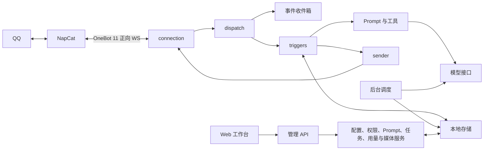

# 架构与开发

[← 文档目录](README.md)

本页按总索引记录的源码基线校准。这里说明当前模块与数据流；运行契约见 [管理文档](management.md)，早期设计保留在 [历史归档](README.md#发布与历史资料)。

## 组成与消息流

NapCat 负责 QQ 登录和协议接入，Bot 通过 OneBot 11 正向 WebSocket 主动连接它。Bot 使用 Node.js ESM，运行依赖为 `ws`（WebSocket）、`proper-lockfile`（运行锁）与 `playwright`（用量分享图截图）；工作台由同一进程提供 HTTP API 和原生 HTML/CSS/JavaScript 静态页面。



1. 连接层解析消息帧，按 `echo` 匹配 API 结果，把事件交给分发器；断线后重连。
2. 分发器先保存事件，再判断消息段、QQ 角色与业务资格。群聊使用 `g-{group_id}`，私聊使用 `p-{user_id}` 作为会话键。
3. 入口依次注册 `poke → ping → draw → meme → command → chat`，匹配即停；触发器继续检查自身开关、权限、唤醒和冷却条件。
4. 聊天捕获已发布的 Prompt 版本，组装当前输入、人设、记忆与筛选后的历史，必要时附图。模型工具可绘图、读写记忆、收藏／查找／发送表情，参数与作用范围由后端校验。
5. 所有 QQ 出站消息经过 sender 的统一队列。普通聊天可延迟、分段和引用；戳一戳只发一句短回复。模型 SSE 流在服务端合并，QQ 不逐 token 发送。
6. 后台调度运行记忆提炼与观察数据清理。群聊提炼遵守活跃窗口与休眠规则，目前没有主动发 QQ 消息的任务类型。

具体接收边界见 [OneBot 接收契约](onebot-reception.md)；当前使用 `send_msg`、`get_group_msg_history` 和 `get_msg`，详见 [协议参考](napcat-protocol.md#本项目-api-使用记录)。

## 代码放在哪里

| 位置 | 职责 |
| --- | --- |
| [`src/index.js`](../src/index.js) | 服务装配、触发器注册、连接启动与停机 |
| [`src/connection/`](../src/connection/)、[`src/protocol/`](../src/protocol/)、[`src/dispatch/`](../src/dispatch/) | WS 与 API、事件归一化、会话与触发器分发 |
| [`src/triggers/`](../src/triggers/)、[`src/sender/`](../src/sender/) | 业务触发、回复加工与统一发送 |
| [`src/prompt/`](../src/prompt/)、[`prompts/`](../prompts/README.md) | Prompt 加载、版本、组装、测试、trace 与默认正文 |
| [`src/tools/`](../src/tools/)、[`src/memes/`](../src/memes/) | 模型工具、图片投递、共享表情收藏与检索 |
| [`src/llm.js`](../src/llm.js)、[`src/imagegen.js`](../src/imagegen.js) | 对话／视觉／提炼及图片生成请求 |
| [`src/distill/`](../src/distill/) | 记忆提炼、校验、失败退避与群聊活跃窗口 |
| [`src/platform/`](../src/platform/) | 运行锁、配置、权限、持久化、调度及用量策略 |
| [`src/usage/`](../src/usage/) | 用量与费用聚合、价目快照、请求稳定性统计和浏览器截图 |
| [`src/utils/logger.js`](../src/utils/logger.js)、[`src/utils/log-format.js`](../src/utils/log-format.js) | 结构化业务日志、脱敏、过滤及终端／网页共用的结果文案 |
| [`src/store/`](../src/store/) | 消息、事件、人设、会话状态、用量和媒体存储 |
| [`src/admin/`](../src/admin/)、[`web/`](../web/) | 管理 API、素材读取服务和网页工作台 |
| [`web/usage-view.js`](../web/usage-view.js)、[`web/request-view.js`](../web/request-view.js) | 用量页面与分享图的共用模板、请求统计页面视图 |
| [`scripts/`](../scripts/)、[`test/`](../test/) | NapCat 初始化、隔离浏览器检查与自动化测试 |

## 配置与数据

| 入口 | 生效方式 |
| --- | --- |
| [`.env.example`](../.env.example) → `.env` | 连接、密钥、模型、路径和端口，启动时读取；已有进程环境变量优先 |
| [`config.example.json`](../config.example.json) → `config.json` | 行为初值，启动时合并默认配置 |
| 工作台配置中心 | 保存并校验后对后续请求生效，优先于行为初值 |
| Prompt 工作台 | 草稿经测试和评审后发布；新请求使用新版本，初始人设仅影响新建／重置会话 |
| [`prompts/`](../prompts/README.md) | 仓库默认模板，重启后加载；不覆盖已有发布配置和会话人设 |

默认运行数据都在 `data/`，采用 JSON、JSONL、Markdown 和媒体原文件，无数据库服务。`PERSONA_DIR`、`USAGE_DIR` 可独立覆盖路径。`napcat/QQ` 与 `napcat/config` 保存 QQ 登录数据和接入配置。备份前停止 Bot，并核对所有自定义目录；不要只备份人设而遗漏用量、配置或媒体索引。

同一数据目录只允许一个 Bot 进程。关键文件采用原子替换，但没有跨文件事务；发送队列保存在内存，聊天历史中的 bot 行也不代表 QQ 已送达。每日请求上限包含失败及并发预留，token 限制依据已报告用量，不等于金额或硬性消费上限。更多持久化和停机语义见 [管理文档](management.md)。

## 本地开发与验证

使用 Node.js 22.9+，仓库采用 ESM，网页直接提供静态文件，无前端打包步骤。依赖安装与截图浏览器见 [部署说明](napcat-deployment.md#在宿主机开发)。同一数据目录只能运行一个 Bot；`npm run dev` 监视源码，`npm start` 普通启动，两者读取 `.env`。

日常改动按 [AGENTS.md](../AGENTS.md) 选择轻量验证：文档修改检查内容与链接，代码修改选择受影响的测试文件；没有默认的全流程门槛。以下是入口示例，不是每次必须跑完的清单：

| 修改范围 | 代码入口 | 可选定向测试 |
| --- | --- | --- |
| OneBot 接收与分发 | `src/connection/`、`src/protocol/`、`src/dispatch/` | `test/connection.test.js`、`test/event-reception.test.js`、`test/dispatch.test.js` |
| 聊天、图片上下文与发送 | `src/triggers/chat*.js`、`src/sender/` | `test/chat.test.js`、`test/chat-context.test.js`、`test/vision.test.js`、`test/sender.test.js` |
| 模型请求与流式读取 | `src/llm.js`、`src/imagegen.js`、`src/utils/chat-stream.js` | `test/llm.test.js`、`test/imagegen.test.js`、`test/chat-stream.test.js` |
| Prompt 与模型工具 | `src/prompt/`、`src/tools/`、`prompts/` | `test/prompt.test.js`、`test/registry.test.js`、`test/prompt-style.test.js` |
| 表情与媒体 | `src/memes/`、`src/store/media-store.js`、`src/store/meme-library.js` | `test/meme-library.test.js`、`test/meme-service.test.js`、`test/media-gallery-api.test.js` |
| 人设记忆与后台提炼 | `src/distill/`、`src/store/persona-store.js` | `test/distill.test.js`、`test/memory-activity.test.js`、`test/persona-store.test.js` |
| 配置、权限与调度 | `src/platform/` | `test/platform.test.js`、`test/scheduler.test.js`、`test/runtime-lock.test.js` |
| 用量、费用与截图 | `src/usage/`、`src/platform/usage-policy.js` | `test/usage-dashboard.test.js`、`test/usage-report.test.js`、`test/usage-policy.test.js` |
| 业务日志与稳定性 | `src/utils/logger.js`、`src/utils/log-format.js`、`src/usage/requests.js` | `test/structured-logger.test.js`、`test/business-trace.test.js`、`test/requests.test.js` |
| 管理 API 与页面 | `src/admin/`、`web/` | `test/admin.test.js`、`test/console.test.js`；跨服务需要时选 `test/admin-integration.test.js` |

例如只修改流式解析时：

```sh
node --test test/chat-stream.test.js
```

按实际影响增加调用方测试即可。`npm test` 为全量测试，仅在明确要求或定向验证不足以覆盖影响时使用。

需要真实浏览器验证时，可选 `scripts/check-prompt-console.mjs` 或 `scripts/check-request-console.mjs`；前者覆盖 Prompt 编辑到发布与页面布局，后者覆盖请求筛选、明细与链路。均使用临时数据与本地模拟服务，需要 Chromium；支持 `CHROME_EXECUTABLE` 和 `SCREENSHOT_DIR`。它们不等于真实 QQ 或模型效果验收。

## 版本与文档基线

`/version` 由 `src/version.js` 读取 CHANGELOG 首个数字版本标题；提交标题不会自动改变运行时版本。2026-11-04 校准时，开发提交标题已到 `0.33.0`，CHANGELOG 数字版本及包文件仍是 `0.30.0`；本次仅记录差异，不推断新发布版本。下一次版本收尾按 AGENTS.md 统一基线。

项目版本与 Prompt 工作台发布版本是两套独立编号。文档生命周期与校准节点统一在 [总索引](README.md) 维护，历史测试数量不作为当前验收结果。
