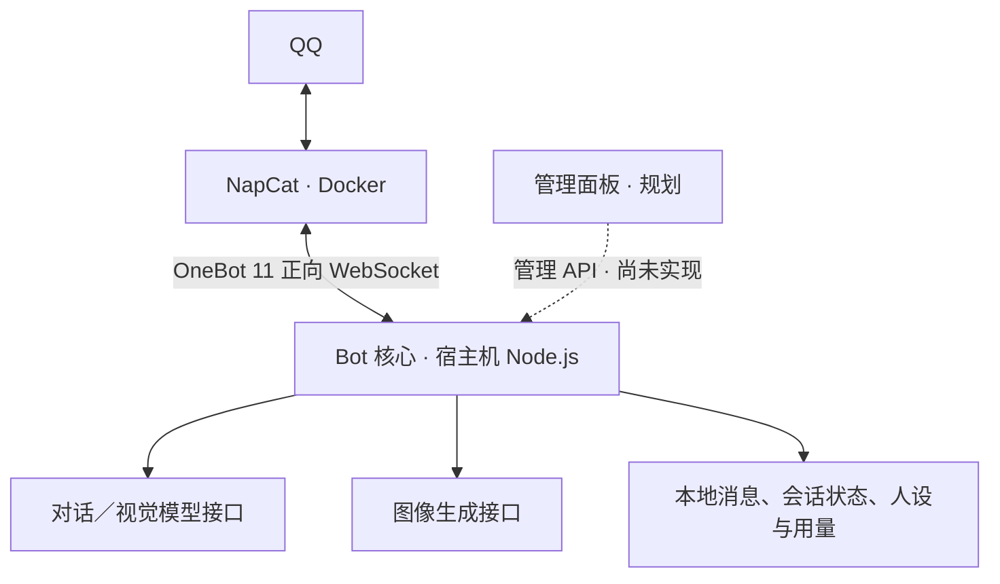
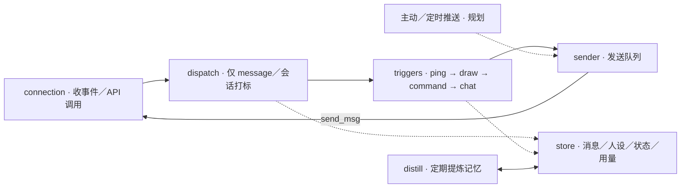

# QQ Chat Bot 架构方向文档

> **历史归档 · 2026-10-26**：保留当时的设计、阶段范围和验证记录；文中的“当前”“规划”“未实现”均指当时状态。最新功能见 [项目首页](../../README.md)，现行结构见 [架构与开发](../architecture.md)，运行契约见 [管理文档](../management.md)。

> 2026-10-26 实现更新：完整 OneBot 接收与本地管理平台已落地。配置、持久化、权限、调度、日志、用量和监控的当前契约以 [管理与公共服务](../management.md) 为准；本文后续技术选型和路线图保留规划背景。

> 文档版本：v0.4 · 2026-10-26；实现基线：`c167cca`（`0.11.0`）。
> 定位：说明项目目标、当前架构与阶段边界。具体消息流见 [Bot 核心设计](bot-core-design.md)，功能演进见 [CHANGELOG](../../CHANGELOG.md)。标为“规划”的能力尚未实现。

## 1. 项目目的

搭建一个自己长期使用、方便调整的个人 QQ 机器人。NapCat 负责登录与 QQ 协议接入，自研核心负责触发规则、对话、人设、记忆、回复加工及发送。

当前已具备文本对话、识图、绘图、指令和记忆提炼。下一阶段补齐常用输入、Prompt 体验、主动／定时场景、前端管理与用量管理，形成可使用、可调整、可观察的日常运行闭环。

## 2. 业务边界

| 范围 | 状态与边界 |
|---|---|
| 群聊／私聊回复 | 已实现规则触发、上下文、人设记忆、回复延迟／拆段／引用 |
| 人设与记忆维护 | 已实现显式指令写入、按会话提炼、审计与失败退避 |
| 多模态 | 已实现有文本对话中的单图理解、白名单文生图；纯图片等输入仍需扩展 |
| 主动／定时推送 | 规划；先确认具体用途、目标会话、触发方式和启停规则 |
| 配置／提示词管理面板 | 规划；先覆盖日常调整和明确的生效反馈 |
| 用量管理 | 已有部分调用记录与会话汇总；统计完整性、可视化与限制能力待补齐 |

本阶段不承担 QQ 协议实现、通用 Bot 平台、多账号与高并发服务。接收类型按真实需求逐项扩展，不以覆盖全部 OneBot 事件为阶段目标。

## 3. 总体架构



- **NapCat**：负责登录、QQ 接入和 OneBot 事件／API；替换接入实现时仍需验证所用扩展 API 的兼容性。
- **Bot 核心**：负责业务行为，通过统一发送队列回复；模型接口和文件存储由核心组织。
- **管理面板**：后续通过核心提供的管理 API 编辑配置与提示词、查看用量，不直接操作 NapCat 业务。

## 4. Bot 核心内部方向



扩展点有三个：注册业务触发器、添加群聊触发条件、添加回复加工模块。普通聊天按“条件判断 → 上下文与人设 → 模型调用 → 回复加工 → 回存与发送”执行。

已有的 `distill` 定时器只整理人设和记忆，不发送定时消息。主动／定时推送的任务模型、恢复策略与存储形态待具体业务确定。

## 5. 项目结构与职责

```text
big-fat-fish-3/
├── docker-compose.yml        # 目前只编排 NapCat
├── package.json              # Node.js ESM，运行依赖 ws
├── .env.example              # 连接、模型、密钥、路径等配置模板
├── config.example.json       # 触发条件、回复处理、历史预算模板
├── src/
│   ├── index.js              # 触发器注册、接线、连接与提炼器启动
│   ├── config.js             # 环境变量与行为配置读取
│   ├── connection/           # WebSocket、重连、echo 匹配与 API 超时
│   ├── dispatch/             # message 筛选、sessionKey、触发器注册与派发
│   ├── triggers/             # ping／draw／command／chat，条件与回复加工模块
│   ├── sender/               # 全局发送队列、近期机器人消息 ID
│   ├── store/                # 消息、人设、会话状态、用量持久化
│   ├── distill/              # 人设／记忆提炼调度与校验
│   ├── llm.js                # 对话与视觉请求出口
│   ├── imagegen.js           # 绘图请求与结果归一
│   ├── version.js            # 从 CHANGELOG 读取 /version
│   └── utils/                # 文本／图片提取、@ 判定、日志等
├── test/                     # 单元测试与本地模拟服务集成测试
├── data/                     # 默认数据目录，运行时生成，Git 忽略
├── napcat/                   # QQ 登录态与 NapCat 配置挂卷，Git 忽略
└── tmp/                      # 测试等临时文件，Git 忽略
```

职责约定与当前实现：

1. 连接层负责协议与连接，不包含聊天业务；分发器根据注册表选择触发器。
2. 触发器契约为 `{ name, match(event), handle(ctx) }`，按注册顺序匹配，命中即停；一个触发器可以发送多条消息。
3. 所有出站消息经过 `sender`。`ping` 和普通指令使用 `ctx.reply()`；聊天与绘图分别处理回存内容后调用 sender。
4. 当前识图在 `chat.js` 直接调用连接层的 `get_group_msg_history` 查询近图，这是现有读取路径；它不绕过发送队列发消息。
5. 新业务可增加触发器；新增 `notice`／`request` 等事件类型还需要扩展分发边界与上下文形状，不能只注册触发器。

## 6. 协议与配置

接入使用 OneBot 11 正向 WebSocket。项目还使用 NapCat 的 `get_group_msg_history` 扩展查询近期群图片。接口清单见 [napcat-protocol.md](../napcat-protocol.md)，实际使用范围以该文档 §4.6 和代码为准。

| 配置入口 | 当前职责 | 生效方式 |
|---|---|---|
| 环境变量／`.env` | 连接、密钥、模型、路径、超时、权限名单等 | 启动读取；`npm start`／`npm run dev` 加载 `.env` |
| `config.json` | 群聊触发条件、延迟／拆段／引用、历史预算 | 启动时合并默认值；修改后重启，没有热加载 |
| 会话 `character.md`／`memory.md` | 人设与事实记忆 | 对话／提炼时读取，指令可写入 |
| 源码中的提示词 | 种子人设、聊天场景规则、提炼模板 | 目前随源码维护，前端管理需补充编辑与生效机制 |

未配置聊天 Key 时不启用 chat 和提炼器；未配置绘图 Key 时不启用 draw。权限并非全局拒绝所有对话：群聊管理指令使用 `ADMIN_QQ`，绘图在群聊／私聊均向所有用户开放（群聊仍须 @），普通聊天与教学指令另按各自触发规则处理。

## 7. 部署形态

当前 Compose 包含 NapCat 和 Bot，NapCat 映射 `3001`（OneBot WS）和 `6099`（WebUI）。可用 `docker compose up -d --build` 启动两者；也可只启动 NapCat，再在宿主机从项目根目录通过 `npm start` 启动 Bot，开发时使用 `npm run dev`。两种 Bot 运行方式二选一；`npm test` 运行本地模拟测试。

NapCat 登录态与配置由 `napcat/` 挂卷保存，启动时固定本地设备标识、选择账号快速登录并自动同步 WS 配置，详见 [NapCat 部署说明](../napcat-deployment.md)。QQ 要求手机验证时仍需人工授权。Bot 默认将数据写到本地 `data/`。`DATA_DIR`、`PERSONA_DIR` 和 `USAGE_DIR` 是独立配置，迁移数据时需一起核对。

当前没有管理 API、面板容器、通用定时任务服务或持久化发送队列。

## 8. 技术栈

| 部分 | 选型与现状 |
|---|---|
| Bot 核心 | Node.js ESM，无框架；当前运行依赖仅 `ws`，HTTP 请求使用内置 fetch |
| 模型调用 | 对话／视觉使用兼容 chat completions 的接口，绘图使用兼容 images generations 的接口；地址与模型可配置 |
| 存储 | JSONL 保存消息、用量和审计；JSON 保存会话状态；Markdown 保存人设与记忆 |
| 测试 | Node.js 内置测试运行器；本地模拟 OneBot、LLM 和图像服务 |
| 接入层 | NapCat，Docker Compose |
| 前端面板 | 原规划 Next.js，尚未建工程；实施时按管理范围确定 |

## 9. 下一阶段范围与完成标准

| 方向 | 范围 |
|---|---|
| 接收类型 | 按常用场景选定输入／事件，补齐触发、内容提取和异常处理；纯图片等是候选 |
| Prompt 工程 | 用真实聊天案例改善人设一致性、群聊分寸、上下文衔接和记忆使用 |
| 主动／定时 | 确认具体业务后实现目标会话、时间／触发条件、启停与恢复规则 |
| 前端管理 | 覆盖首批配置与提示词，明确编辑、保存和生效反馈 |
| 用量管理 | 补齐统计口径与缺失调用，提供按时间／会话／用途查看及选定的限制能力 |

建议优先推进 Prompt 体验与日常管理闭环；其余按真实需求确定顺序，尚未排期。阶段完成需要同时满足：群友用得顺、维护者调得动、异常和重启下能持续运行。

“代码已实现”不等于“真实使用已验收”。自动化测试使用模拟服务，真实 QQ、真实模型效果和长期运行情况需另行记录。
