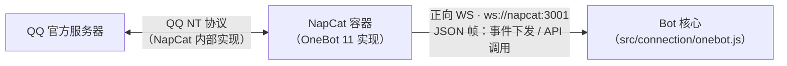

# NapCat 协议清单（OneBot 11）

> 版本：v1.1 · 2026-10-26
> 本次仅对照代码更新项目配置约定、权限说明与 §4.6 使用记录；通用协议清单保留 2026-10-24 的资料快照，未重新核验上游全部接口。
> 定位：Bot 核心与 NapCat 对接的唯一协议参考。传输层、事件、API 均以本清单为准；字段级权威定义见文末来源链接。
> 本项目传输层结论：**采用并推荐「正向 WebSocket」**（详见第 2 节标注）。

---

## 目录

1. [协议总览](#1-协议总览)
2. [传输层协议](#2-传输层协议)
3. [事件协议](#3-事件协议)
4. [API 接口清单](#4-api-接口清单)
5. [鉴权与安全](#5-鉴权与安全)
6. [参考来源](#6-参考来源)

---

## 1. 协议总览

NapCat 是基于 NTQQ 的无头 QQ 客户端框架，对 Bot 核心暴露标准化的 **OneBot 11** 协议。Bot 核心不认识 QQ，只认识 OneBot 11。



协议分三层：

| 层 | 内容 | 方向 |
|---|---|---|
| 传输层 | HTTP / WS 等通信方式、鉴权、帧格式 | Bot ←→ NapCat |
| 事件协议 | `post_type` 四大类事件（message / notice / request / meta_event） | NapCat → Bot（下发） |
| API 接口 | `action` 调用清单（OneBot 11 标准 + go-cqhttp 兼容 + NapCat 扩展） | Bot → NapCat（上调） |

---

## 2. 传输层协议

### 2.1 NapCat 支持的通信方式总表

NapCat 支持同时开启多个网络服务，每种服务在配置文件 `napcat/config/onebot11_<QQ号>.json` 的 `network` 下有对应的配置数组：

| 通信方式 | 配置键 | 模型 | 事件推送 | API 调用 | 适用场景 | 本项目 |
|---|---|---|---|---|---|---|
| HTTP 服务端 | `httpServers` | 单工 | 不推送（用 SSE 补充） | 支持（POST 调用） | 无状态脚本、单次调用 | 关闭 |
| HTTP 客户端 | `httpClients` | 单工 | 推送（HTTP POST 上报） | 不支持（需另配 HTTP 服务端） | 框架侧无监听能力、回调式开发 | 关闭 |
| HTTP SSE 服务端 | `httpSseServers` | 单工下行 | 推送（SSE 流） | 不支持（需另配 HTTP 服务端） | 只读事件流场景（较新版本支持） | 关闭 |
| **WebSocket 服务端（正向 WS）** | `websocketServers` | **全双工** | **支持** | **支持** | **常驻 Bot 服务，单连接收发一体（推荐）** | **启用** |
| WebSocket 客户端（反向 WS） | `websocketClients` | 全双工 | 支持 | 支持 | Bot 侧已有 WS 服务端、NapCat 在 NAT 内无法被连时 | 关闭 |
| 插件 | `plugins` | — | — | — | NapCat 内置插件桥接（扩展槽位，详见 WebUI） | 关闭 |

> 依据官方配置指南：HTTP 服务端 = NapCat 作为 HTTP 请求接受方（单工）；HTTP 客户端 = NapCat 作为请求发起方向框架推送事件（单工）；WS 服务端 = 通常称「正向 WS」，既能主动推送事件也能接收请求（双工）；WS 客户端 = 通常称「反向 WS」，同为双工。

### 2.2 推荐：正向 WS（本项目采用）

**标注：正向 WS 为本项目唯一启用的传输方式，也是本项目推荐方式。** 理由：

1. **单连接全双工**：一条连接同时承担「事件下发」与「API 调用」，事件响应路径最短，天然契合本项目 `connection → dispatch → triggers → sender` 的单向数据流；
2. **连接方向友好**：Bot 主动连 NapCat，Bot 侧无需暴露任何监听端口，Docker 网络内 `ws://napcat:3001` 直连即可；
3. **调用模型同 RPC**：请求带 `echo`、响应原样携带 `echo` 返回，与现有 [onebot.js](src/connection/onebot.js) 的 echo 匹配实现完全一致；
4. **心跳保活**：内置 `heartInterval` 心跳与 `lifecycle.connect` 事件，便于连接层判断链路健康。

对比说明：HTTP 服务端/客户端把「收事件」和「调 API」拆成两条链路，且 HTTP POST 模式还需要处理签名，对常驻 Bot 是额外复杂度；反向 WS 与正向 WS 能力等价，只是连接方向相反，适合 NapCat 无法被主动连接的场景——本项目两者同处一个 Docker 网络，无此需求。

### 2.3 正向 WS 通信细节（帧格式）

**连接与鉴权**

- 连接地址：`ws://<host>:3001`（本项目为 `ws://napcat:3001`）；
- 鉴权：请求头 `Authorization: Bearer <token>`（也支持 `?access_token=` 查询参数）；鉴权失败连接直接断开，不会进入 API 调用阶段；
- 连接成功后 NapCat 推送 `meta_event.lifecycle`（`sub_type: connect`）。

**请求帧（Bot → NapCat，调用 API）**

```json
{ "action": "send_group_msg", "params": { "group_id": 123, "message": [] }, "echo": "1" }
```

**响应帧（NapCat → Bot）**

```json
{ "status": "ok", "retcode": 0, "data": { "message_id": 456049 }, "echo": "1", "wording": "" }
```

| 字段 | 类型 | 说明 |
|---|---|---|
| `status` | string | `ok` 成功 / `failed` 失败 / `async` 已提交异步执行 |
| `retcode` | number | `0` 成功；非 0 失败（见下表） |
| `data` | any | 响应数据，失败时可能为 `null` |
| `echo` | — | 原样返回请求中的 `echo`，用于请求-响应匹配 |
| `wording` | string | 人类可读的错误描述（失败时参考） |

**retcode 对照**（OneBot 11 标准，WS 下由 HTTP 状态码映射而来）：

| retcode | 含义 |
|---|---|
| 0 | 成功 |
| 1400 | 参数无效 |
| 1401 | 鉴权失败（实际中连接早已断开，很少出现） |
| 1403 | 被禁止调用 |
| 1404 | action 不存在 |

**事件帧（NapCat → Bot，事件推送）**

与 HTTP POST 上报格式完全一致：带 `post_type` 字段的 JSON 对象（详见第 3 节）。区别：WS 推送无签名，也不处理响应。

**心跳**

NapCat 按 `heartInterval`（本项目 30000ms）周期推送 `meta_event.heartbeat`；连接层若连续多个周期未收到心跳应视为链路异常并重连。

**快速操作说明**

OneBot 11 的「快速操作」（如消息事件回包直接带 `reply`）是 HTTP POST 模式专有；**WS 模式下需显式调用 `.handle_quick_operation` API**（见 4.5），或直接调用 `send_msg` 等发送接口——本项目采用后者（`ctx.reply()` → sender → `send_msg`）。

### 2.4 本项目配置约定

本项目使用正向 WS。以下是接入约定与原配置记录，不表示本次检查了正在运行的 NapCat 实例；实际值需与本地 `napcat/config/onebot11_<QQ号>.json` 和 `.env` 对齐：

| 字段 | 值 | 说明 |
|---|---|---|
| `name` | `bot-core` | 服务唯一标识 |
| `enable` | `true` | 启用 |
| `host` / `port` | `0.0.0.0` / `3001` | 监听地址；docker-compose 已映射宿主机 3001 |
| `messagePostFormat` | `array` | 事件消息以**消息段数组**上报（本项目约定，见 3.4） |
| `reportSelfMessage` | `false` | 不上报 Bot 自身发出的消息 |
| `heartInterval` | `30000` | 心跳周期 30s |
| `token` | 与 `ONEBOT_ACCESS_TOKEN` 一致，文档不记录值 | Bot 配置非空时以 Bearer 头携带 |
| `enableForcePushEvent` / `debug` | `true` / `false` | 强制事件推送开关 / raw 数据上报（调试用） |

容器端口：`6099`（WebUI，扫码与网络配置）、`3001`（正向 WS）。Bot 侧连接代码见 [onebot.js](src/connection/onebot.js)（`callApi` 带 echo 匹配、15s 超时、断线 5s 重连）。

---

## 3. 事件协议

### 3.1 公共字段

所有事件都携带：

| 字段 | 类型 | 说明 |
|---|---|---|
| `time` | int64 | 事件发生时间戳（秒） |
| `self_id` | int64 | 收到事件的 Bot QQ 号 |
| `post_type` | string | 事件大类：`message` / `notice` / `request` / `meta_event` |

事件全部以 JSON 推送；`message` 字段的实际形态由 `messagePostFormat` 决定（本项目为 `array`）。

### 3.2 事件分类总表

| post_type | 子类 | sub_type 可能值 | 触发场景 | 本项目关注 |
|---|---|---|---|---|
| `message` | `private` | `friend` / `group` / `other` | 私聊消息（好友 / 群临时会话 / 其他） | 是（私聊回复） |
| `message` | `group` | `normal` / `anonymous` / `notice` | 群消息（正常 / 匿名 / 系统提示） | **是（核心触发源）** |
| `notice` | `group_upload` | - | 群文件上传 | 按需 |
| `notice` | `group_admin` | `set` / `unset` | 管理员设置 / 取消 | 按需 |
| `notice` | `group_decrease` | `leave` / `kick` / `kick_me` | 主动退群 / 成员被踢 / 自己被踢 | 按需 |
| `notice` | `group_increase` | `approve` / `invite` | 管理员同意入群 / 被邀请入群 | 是（入群欢迎候选） |
| `notice` | `group_ban` | `ban` / `lift_ban` | 禁言 / 解除禁言 | 按需 |
| `notice` | `friend_add` | - | 新好友添加 | 按需 |
| `notice` | `group_recall` | - | 群消息撤回 | 按需（撤回补发候选） |
| `notice` | `friend_recall` | - | 好友消息撤回 | 按需 |
| `notice` | `notify` | `poke` / `lucky_king` / `honor` | 戳一戳 / 红包运气王 / 群荣誉变更 | **是（戳一戳触发器）** |
| `request` | `friend` | - | 加好友请求 | 按需 |
| `request` | `group` | `add` / `invite` | 加群请求 / 邀请登录号入群 | 按需 |
| `meta_event` | `lifecycle` | `connect`（WS 模式） | WebSocket 连接建立 | 是（连接层就绪判据） |
| `meta_event` | `heartbeat` | - | 心跳（间隔见 `heartInterval`） | 是（链路健康检查） |

### 3.3 消息事件字段

**私聊消息（post_type=message, message_type=private）**

| 字段 | 类型 | 说明 |
|---|---|---|
| `message_id` | int32 | 消息 ID（撤回、回复引用时使用） |
| `user_id` | int64 | 发送者 QQ 号 |
| `message` | array | 消息段数组（见 3.4） |
| `raw_message` | string | 原始消息内容 |
| `font` / `sender` | - | 字体 / 发送人信息（尽力提供，可能有缓存延迟） |

sender：`user_id`、`nickname`、`sex`、`age`。

**群消息（post_type=message, message_type=group）**

| 字段 | 类型 | 说明 |
|---|---|---|
| `message_id` | int32 | 消息 ID |
| `group_id` | int64 | 群号 |
| `user_id` | int64 | 发送者 QQ 号 |
| `anonymous` | object / null | 匿名信息（非匿名消息为 null），含 `id`、`name`、`flag` |
| `message` | array | 消息段数组 |
| `raw_message` | string | 原始消息内容 |
| `sender` | object | 发送人信息 |

sender：`user_id`、`nickname`、`card`（群名片）、`sex`、`age`、`area`、`level`、`role`（`owner`/`admin`/`member`）、`title`。字段为尽力提供，不保证全量存在。`role` 表示 QQ 群身份；本项目当前的管理权限使用 `ADMIN_QQ` 白名单，绘图向所有用户开放，不直接依据 `sender.role` 授权。

> 触发器契约提醒：本项目触发器以 `match(event)` 匹配后，回复通过 `ctx.reply()` 走 sender 收口（见架构文档第 4 节），不使用 WS 下不可用的「快速操作」回包。

### 3.4 消息段格式（array，本项目约定）

`messagePostFormat: "array"` 时，`message` 字段为消息段数组，每段形如 `{ "type": "...", "data": {...} }`。NapCat 对各消息段的收/发支持（官方兼容表）：

| type | 说明 | 收 | 发 |
|---|---|---|---|
| `text` | 纯文本 | ✅ | ✅ |
| `face` | QQ 经典表情 | ✅ | ✅ |
| `image` | 图片（含商城表情，收到时 `file` 为 `marketface`） | ✅ | ✅ |
| `record` | 语音 | ✅ | ✅ |
| `video` | 视频 | ✅ | ✅ |
| `at` | @某人（`qq: "all"` 为 @全体成员） | ✅ | ✅ |
| `rps` / `dice` | 猜拳 / 骰子 | ✅ | ✅ |
| `poke` | 戳一戳（事件上报与接口调用，不通过消息） | ✅ | ✅ |
| `share` | 链接分享（收到为 json 段） | ✅ | ❌ |
| `contact` | 推荐好友/群聊 | ✅ | ✅ |
| `location` | 位置 | ✅ | ❌ |
| `music` | 音乐分享（qq/163/kugou/migu/kuwo/custom） | ✅ | ✅ |
| `reply` | 回复消息（引用，data.id 为被回复消息 ID） | ✅ | ✅ |
| `forward` | 合并转发（收到时含 content） | ✅ | ✅ |
| `node` | 合并转发节点（id 与 content 二选一；可伪造 user_id/nickname） | ✅ | ✅ |
| `json` | JSON 消息 | ✅ | ✅ |
| `mface` | QQ 表情包 | ✅ | ✅ |
| `file` | 文件 | ✅ | ✅ |
| `markdown` | Markdown（仅双层合并转发内可发） | ❌ | ✅ |

常用示例：

```json
[ { "type": "text", "data": { "text": "pong" } } ]

[ { "type": "at", "data": { "qq": "10001" } }, { "type": "text", "data": { "text": " 你好" } } ]

[ { "type": "reply", "data": { "id": "456049" } }, { "type": "image", "data": { "file": "https://example.com/a.png" } } ]
```

发送时 `image`/`record`/`video`/`file` 的 `file` 字段支持：本地路径、`http(s)://`、`file://`、`base://`（base64）等 URI。

### 3.5 通知事件（notice）关键字段速查

| notice_type | 关键字段 | 备注 |
|---|---|---|
| `group_upload` | `group_id`、`user_id`、`file{id,name,size,busid}` | 群文件上传 |
| `group_admin` | `group_id`、`user_id`、`sub_type(set/unset)` | 管理员变动 |
| `group_decrease` | `group_id`、`operator_id`、`user_id`、`sub_type(leave/kick/kick_me)` | 退群/踢人 |
| `group_increase` | `group_id`、`operator_id`、`user_id`、`sub_type(approve/invite)` | 入群 |
| `group_ban` | `group_id`、`operator_id`、`user_id`、`duration`、`sub_type(ban/lift_ban)` | duration 单位秒 |
| `friend_add` | `user_id` | 新好友 |
| `group_recall` | `group_id`、`user_id`、`operator_id`、`message_id` | 群撤回 |
| `friend_recall` | `user_id`、`message_id` | 私聊撤回 |
| `notify`/`poke` | `group_id`、`user_id`、`target_id` | 戳一戳；**本项目戳一戳触发器消费此事件** |
| `notify`/`lucky_king` | `group_id`、`user_id`、`target_id` | 红包运气王 |
| `notify`/`honor` | `group_id`、`user_id`、`honor_type(talkative/performer/emotion)` | 群荣誉变更 |

### 3.6 请求事件（request）关键字段

| request_type | 关键字段 | 处理 API |
|---|---|---|
| `friend` | `user_id`、`comment`、**`flag`** | `set_friend_add_request`（flag 必须回传） |
| `group` | `group_id`、`user_id`、`comment`、**`flag`**、`sub_type(add/invite)` | `set_group_add_request`（flag + sub_type 必须回传） |

### 3.7 元事件（meta_event）

| meta_event_type | 关键字段 | 说明 |
|---|---|---|
| `lifecycle` | `sub_type: connect` | WS 连接成功时上报一次；连接层以此为就绪信号 |
| `heartbeat` | `status`（运行状态对象）、`interval`（毫秒） | 周期 = 配置 `heartInterval`（本项目 30s） |

---

## 4. API 接口清单

### 4.1 调用方式

统一通过 [onebot.js](src/connection/onebot.js) 的 `callApi(action, params)`：发送 `{action, params, echo}` 帧，按 `echo` 匹配响应；`retcode === 0` 时 resolve `data`，否则 reject（携带 `wording`）。以下清单按三组划分：OneBot 11 标准（NapCat 全量实现）、go-cqhttp 兼容扩展、NapCat 私有扩展。

### 4.2 OneBot 11 标准 API

**消息类**

| API | 参数 | 响应 | 说明 |
|---|---|---|---|
| `send_private_msg` | `user_id`、`message`、`auto_escape?` | `message_id` | 发送私聊消息 |
| `send_group_msg` | `group_id`、`message`、`auto_escape?` | `message_id` | 发送群消息（**本项目 ping→pong 已用**） |
| `send_msg` | `message_type?`、`user_id?`、`group_id?`、`message` | `message_id` | 通用发送（sender 层建议统一走此接口） |
| `delete_msg` | `message_id` | - | 撤回消息 |
| `get_msg` | `message_id` | `time/message_type/message_id/real_id/sender/message` | 获取单条消息 |
| `get_forward_msg` | `id`（合并转发 res_id） | `message`（node 段数组） | 解析合并转发 |

**群组管理类**

| API | 参数 | 响应 | 说明 |
|---|---|---|---|
| `send_like` | `user_id`、`times?`（默认 1，每日上限 10） | - | 好友点赞 |
| `set_group_kick` | `group_id`、`user_id`、`reject_add_request?` | - | 踢人（需管理员/群主） |
| `set_group_ban` | `group_id`、`user_id`、`duration?`（秒，0 解禁，默认 1800） | - | 单人禁言 |
| `set_group_anonymous_ban` | `group_id`、`anonymous`/`flag`、`duration?` | - | 匿名禁言（NapCat 匿名功能受限） |
| `set_group_whole_ban` | `group_id`、`enable?`（默认 true） | - | 全员禁言 |
| `set_group_admin` | `group_id`、`user_id`、`enable?` | - | 设置/取消管理员 |
| `set_group_anonymous` | `group_id`、`enable?` | - | 匿名开关 |
| `set_group_card` | `group_id`、`user_id`、`card?` | - | 设置群名片 |
| `set_group_name` | `group_id`、`group_name` | - | 设置群名 |
| `set_group_leave` | `group_id`、`is_dismiss?` | - | 退群/解散 |
| `set_group_special_title` | `group_id`、`user_id`、`special_title?`、`duration?` | - | 专属头衔 |
| `set_friend_add_request` | `flag`、`approve?`、`remark?` | - | 处理加好友请求 |
| `set_group_add_request` | `flag`、`sub_type`、`approve?`、`reason?` | - | 处理加群请求/邀请 |

**查询与系统类**

| API | 参数 | 响应 | 说明 |
|---|---|---|---|
| `get_login_info` | - | `user_id`、`nickname` | 登录号信息 |
| `get_stranger_info` | `user_id`、`no_cache?` | `user_id/nickname/sex/age` | 陌生人信息 |
| `get_friend_list` | - | 数组：`user_id/nickname/remark` | 好友列表 |
| `get_group_info` | `group_id`、`no_cache?` | `group_id/group_name/member_count/max_member_count` | 群信息 |
| `get_group_list` | - | 同 `get_group_info` 数组 | 群列表（**定时推送选目标群时用**） |
| `get_group_member_info` | `group_id`、`user_id`、`no_cache?` | 含 `nickname/card/role/level/join_time/last_sent_time` 等 | 群成员信息；当前核心未调用此 API 做权限判断 |
| `get_group_member_list` | `group_id` | 同上数组 | 群成员列表 |
| `get_group_honor_info` | `group_id`、`type`（talkative/performer/legend/strong_newbie/emotion/all） | 各荣誉列表 | 群荣誉 |
| `get_record` | `file`、`out_format` | `file`（转换后路径） | 语音转换（需 ffmpeg） |
| `get_image` | `file` | `file`（下载后路径） | 收图信息（NapCat 增强为含 url 等） |
| `can_send_image` / `can_send_record` | - | `yes: boolean` | 能力探测 |
| `get_status` | - | `online`、`good`、统计字段 | 运行状态 |
| `get_version_info` | - | `app_name/app_version/protocol_version` | 版本信息 |
| `get_cookies` / `get_csrf_token` / `get_credentials` | `domain?` | `cookies` / `token` | QQ 接口凭证（NapCat 为兼容保留，能力有限） |
| `set_restart` | `delay?` | - | 重启实现（NapCat 为兼容保留） |
| `clean_cache` | - | - | 清理缓存（NapCat 为兼容保留） |

> 注：NapCat 实现全部核心标准 API（官方源码 router.ts 收录）；凭证类（get_cookies 系）与 set_restart / clean_cache 属兼容性保留，实际效果以运行版本为准。

### 4.3 go-cqhttp 兼容扩展 API（NapCat 已收录实现的常用部分）

| API | 参数 | 响应 | 说明 |
|---|---|---|---|
| `send_private_forward_msg` | `user_id`、`messages`（node 段数组） | `message_id`、`res_id` | 私聊合并转发 |
| `send_group_forward_msg` | `group_id`、`messages` | `message_id`、`res_id` | 群合并转发 |
| `get_group_msg_history` | `group_id`、`message_seq`、`count`、`reverseOrder?` | `messages` 数组 | 群历史消息 |
| `upload_group_file` | `group_id`、`file`、`name`、`folder_id?` | - | 上传群文件 |
| `upload_private_file` | `user_id`、`file`、`name` | - | 上传私聊文件 |
| `get_group_root_files` | `group_id` | 文件/文件夹列表 | 群根目录文件 |
| `get_group_files_by_folder` | `group_id`、`folder_id` | 文件列表 | 按文件夹列出群文件 |
| `create_group_file_folder` | `group_id`、`name`、`parent_id?` | - | 建群文件夹 |
| `delete_group_file` / `delete_group_folder` | `group_id`、`file_id`/`folder_id` | - | 删除群文件/文件夹 |
| `get_group_system_msg` | - | 系统消息列表 | 群系统消息 |
| `get_essence_msg_list` | `group_id`、`page?` | 精华消息数组 | 精华消息 |
| `ocr_image` | `image` | OCR 结果 | 图片文字识别 |
| `set_group_portrait` | `group_id`、`file` | - | 设置群头像 |
| `send_group_notice` | `group_id`、`content`、`image?` | - | 发送群公告 |
| `set_qq_profile` | `nickname`、`personal_note`... | - | 设置个人资料 |
| `download_file` | `url`、`thread_cnt?`、`headers?` | `file` | 下载文件到缓存目录 |

> 完整清单以 NapCat Apifox 文档（见第 6 节）为准，以上为与 go-cqhttp 对齐的常用子集。

### 4.4 NapCat 私有扩展 API（官方扩展文档 + 源码收录）

**互动类**

| API | 参数 | 响应 | 说明 |
|---|---|---|---|
| `send_poke` | `group_id?`、`user_id`（有 group_id 走群戳，否则好友戳） | - | 戳一戳（二合一入口） |
| `group_poke` | `group_id`、`user_id` | - | 群聊戳一戳 |
| `friend_poke` | `user_id` | - | 私聊戳一戳 |
| `set_msg_emoji_like` | `message_id`、`emoji_id` | - | 消息表情回应 |

**消息/会话类**

| API | 参数 | 响应 | 说明 |
|---|---|---|---|
| `send_forward_msg` | `message_type?`、`user_id?`、`group_id?`、`messages` | `message_id`、`res_id` | 发送合并转发（统一入口） |
| `forward_friend_single_msg` | `user_id`、`message_id` | - | 单条消息转发到私聊 |
| `forward_group_single_msg` | `group_id`、`message_id` | - | 单条消息转发到群 |
| `get_friend_msg_history` | `user_id`、`message_seq?`、`count?`、`reverseOrder?` | `messages` | 私聊历史消息 |
| `get_recent_contact` | `count?` | 会话摘要数组 | 最近会话列表 |
| `mark_private_msg_as_read` | `user_id` | - | 私聊标记已读 |
| `mark_group_msg_as_read` | `group_id` | - | 群聊标记已读 |
| `_mark_all_as_read` | - | - | 全部标记已读 |

**资料/账号类**

| API | 参数 | 响应 | 说明 |
|---|---|---|---|
| `set_online_status` | `status`、`ext_status`、`battery_status?` | - | 设置在线状态 |
| `set_qq_avatar` | `file` | - | 设置 QQ 头像 |
| `set_self_longnick` | `longNick` | - | 设置个性签名 |
| `get_friends_with_category` | - | 分类+好友列表 | 分类好友列表 |
| `get_profile_like` | - | `total_count`、`userInfos` 等 | 自身获赞列表 |
| `set_group_sign` | `group_id` | - | 群签到 |
| `set_group_sign`（`get_group_signed_list`） | `group_id` | 签到列表 | 获取群签到列表（源码收录） |

**文件类**

| API | 参数 | 响应 | 说明 |
|---|---|---|---|
| `get_file` | `file_id` | `file/url/file_size/file_name/base64` | 按 ID 取文件信息（NapCat 主力文件接口） |
| `get_private_file_url` | `file_id`、`user_id` | `url` | 私聊文件下载直链 |
| `move_group_file` | `group_id`、`file_id`、`current_parent_directory_id?`、`target_directory_id?` | - | 群文件移动 |
| `nc_get_rkey` | - | rkey 信息 | 获取多媒体直链 rkey（NapCat 特有） |

**其他**

| API | 参数 | 响应 | 说明 |
|---|---|---|---|
| `ArkSharePeer` | `user_id` 或 `group_id`（二选一） | `arkJson` | 获取推荐名片 |
| `ArkShareGroup` | `group_id` | 卡片 JSON | 获取群推荐卡片 |
| `get_robot_uin_range` | - | `minUin/maxUin` 列表 | 机器人账号范围 |
| `translate_en2zh` | `words: string[]` | 中文字符串数组 | 英译中 |
| `create_collection` / `get_collection_list` | 收藏内容 | - | 创建/获取收藏 |
| `fetch_custom_face` | `count?`（默认 48） | 表情数组 | 获取自定义表情 |
| `get_ai_characters` | `group_id`、`chat_type?` | AI 角色列表 | AI 语音角色 |
| `get_ai_record` | `character`、`group_id`、`text` | `data`（语音链接） | AI 文字转语音 |
| `send_group_ai_record` | `character`、`group_id`、`text` | `message_id` | 群聊发送 AI 语音 |
| `set_group_album_media_like` / `upload_image_to_qun_album` | 群相册相关 | - | 群相册操作（源码收录，较新） |

### 4.5 隐藏 API

| API | 参数 | 说明 |
|---|---|---|
| `.handle_quick_operation` | `context`（事件对象）、`operation`（快速操作对象） | WS 模式下伪造「快速操作」；本项目不使用（直接调 send 系接口更直观） |

### 4.6 本项目 API 使用记录

| API | 状态 | 用途 |
|---|---|---|
| `send_msg` | **已使用**，由 sender 统一调用 | ping、指令、聊天及绘图的群聊／私聊发送，支持文本与消息段数组 |
| `get_group_msg_history` | **已使用**，由 chat 查询 | 识图开启且当前消息无图时，查询最近 20 条群消息，再筛同用户与时间窗内的图片 |
| `send_group_msg` / `send_private_msg` | 当前未直接调用 | 发送统一使用 `send_msg` |
| `get_group_list` / `get_group_member_info` | 规划候选，尚未接入 | 后续管理或推送配置可能使用，具体用途待业务确定 |
| `get_login_info` | 尚未接入 | 可用于后续启动自检 |

当前只处理 `message` 事件；协议支持某类事件或消息段，不代表 Bot 已有对应处理逻辑。无文本消息目前不会进入模型调用，`notice`、`request` 和 `meta_event` 被分发器忽略。

---

## 5. 鉴权与安全

1. **token 配置**：沿用启用鉴权的接入约定；Bot 从 `.env` 的 `ONEBOT_ACCESS_TOKEN` 读取，NapCat 侧存于 `onebot11_<QQ号>.json`，两端需一致。本轮未读取运行中的密钥或确认部署状态；
2. **传递方式**：WS 连接请求头 `Authorization: Bearer <token>`（现行实现），或连接 URL `?access_token=`；
3. **失败行为**：鉴权失败连接直接断开，API 阶段不会执行（故 1401/1403 实际罕见）；
4. **服务范围**：当前 `docker-compose.yml` 映射正向 WS（3001）与 WebUI（6099）；原接入约定关闭 HTTP 系服务，实际启用项以本地 NapCat 配置为准。

---

## 6. 参考来源

**官方 / 权威文档**（本清单依据，访问日期 2026-10-24）：

| 来源 | 链接 | 用途 |
|---|---|---|
| NapCat 官方文档站 | https://napcat.napneko.icu/ | 文档主页（部署、WebUI、扩展 API） |
| NapCat WebUI 配置指南 | https://doc.napneko.icu/config/basic | 传输层四方式定义、onebot11 配置文件格式 |
| NapCat 扩展 API 文档（V4） | https://napneko.github.io/develop/api/doc | 4.4 节私有扩展 API 参数与响应 |
| NapCat 消息格式文档 | https://napneko.github.io/develop/msg | 3.4 节消息段收/发兼容表 |
| NapCat Apifox 接口文档 | https://napcat.apifox.cn/ | 全量接口在线参考 |
| NapCatQQ GitHub 仓库 | https://github.com/NapNeko/NapCatQQ | 源码（action/router.ts 接口注册表） |
| OneBot 11 标准 - 公开 API | https://github.com/botuniverse/onebot-11/blob/master/api/public.md | 4.2 节标准 API 定义 |
| OneBot 11 标准 - 事件 | https://github.com/botuniverse/onebot-11/blob/master/event/README.md | 第 3 节事件定义（message/notice/request/meta） |
| OneBot 11 标准 - 正向 WS | https://github.com/botuniverse/onebot-11/blob/master/communication/ws.md | 2.3 节帧格式与 retcode 对照 |
| go-cqhttp API 文档 | https://docs.go-cqhttp.org/api | 4.3 节兼容扩展对照 |

> 提示：NapCat 版本迭代较快，扩展 API 以官方文档与 Apifox 为准；OneBot 11 标准部分长期稳定。本文与架构文档（qq-chatbot-architecture.md）配套使用。
