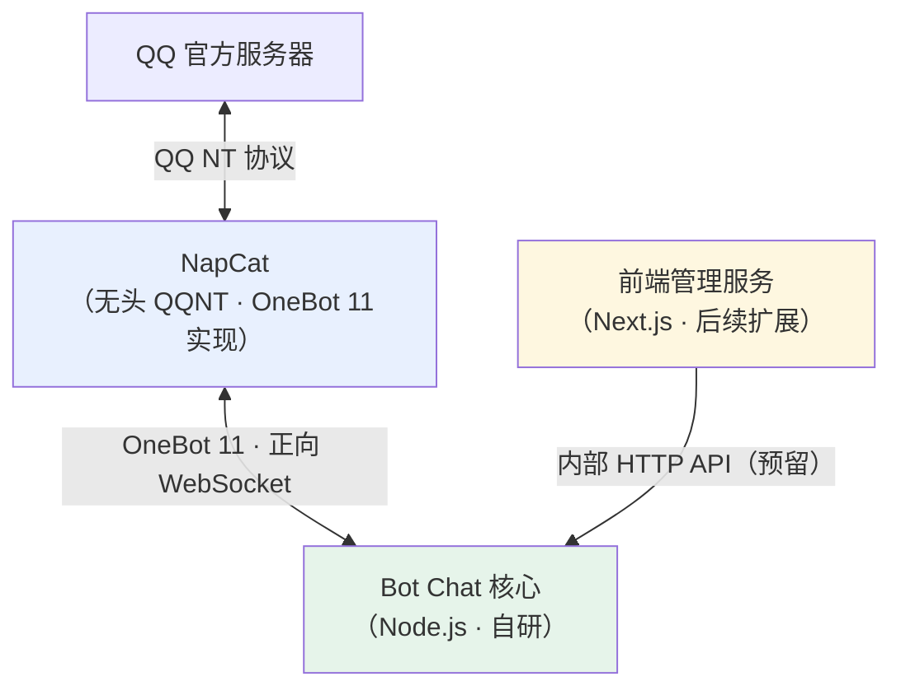
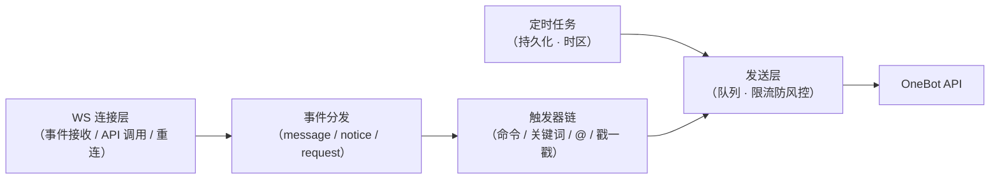
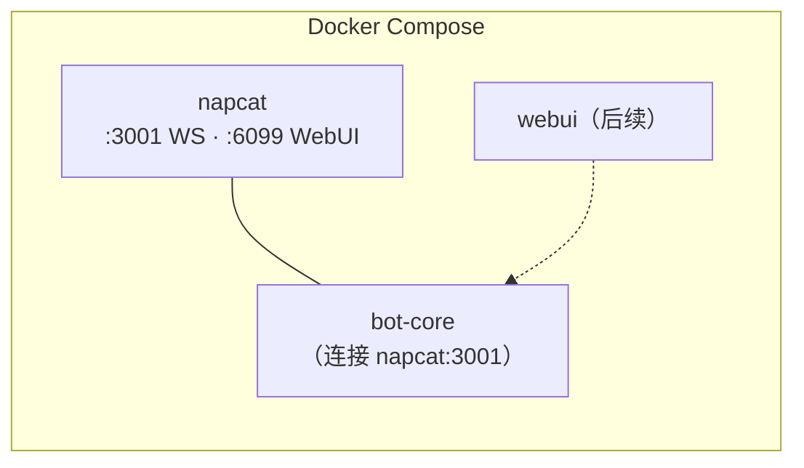

# QQ Chat Bot 架构方向文档

> 版本：v0.2 · 2026-10-24
> 定位：指明项目方向与架构划分，不构成实施规范。实现细节在开发中自行决策。

---

## 1. 项目目的

搭建一个个人 QQ 群聊机器人：

- **消息触发**：根据群聊/私聊内容，按规则自动回复（命令、关键词、@、戳一戳等）；
- **定时触发**：按计划定时向指定会话推送消息；
- **可管理**：后续提供 Web 面板管理定时任务与查看运行状态。

QQ 协议接入不自研，交给成熟的 OneBot 实现（NapCat）；**自研部分聚焦在触发规则与定时任务的组织架构上**——这是项目本身的价值所在。

## 2. 业务边界

| 做 | 不做 |
|---|---|
| 群消息/私聊的规则触发回复 | QQ 协议层实现（NapCat 负责） |
| 定时消息推送与任务持久化 | 通用 bot 框架（不造 NoneBot 轮子） |
| 戳一戳等 notice 事件响应 | 复杂 NLU（按需后接 LLM，另议） |
| 后续：Web 管理面板 | 高并发/多账号（个人自用规模） |

## 3. 总体架构

三个独立部分，单向依赖：

各部分一句话定位：

- **NapCat**：纯管道。管登录、管 QQ 协议、把消息翻译成 OneBot 11 事件。零业务逻辑，可整体替换为其他 OneBot 实现。
- **Bot Chat 核心**：项目主体。事件分发、触发器组织、定时任务、发送队列。只认识 OneBot 11，不认识 QQ。
- **前端管理服务**：只跟 Bot 核心说话，不直连 NapCat。Bot 核心跑稳后再启动。

## 4. Bot 核心内部方向

数据流一条线，各环节职责单一：

设计倾向（非约束）：

- 触发器**注册式**组织：加功能 = 加文件，而非加 if-else；
- 发送层统一收口出站消息，限流只在这一处做；
- 定时任务落盘持久化，重启恢复、错过的跳过；
- 连接建议用正向 WS（Bot 连 NapCat），单连接全双工。

## 5. 协议与文档

Bot 核心只对接一套协议：**OneBot 11**。事件与 API 的完整定义以官方文档为准，本文不复制：

- OneBot 11 标准：https://github.com/botuniverse/onebot-11
- NapCat 文档（部署、WebUI 配置、扩展 API）：https://napcat.napneko.icu/

## 6. 部署形态

Docker Compose，三容器（面板后续加入）：

要点：NapCat 登录态与配置挂卷持久化（重启免扫码）；Bot 核心的 `data/` 目录挂卷（任务持久化）。

## 7. 技术栈

| 部分 | 选型 | 说明 |
|---|---|---|
| Bot 核心 | Node.js（ESM，无框架） | 依赖保持极简（ws 起步）；JS 生态与后续前端统一 |
| 前端面板 | Next.js | 后续扩展，仅调 Bot 核心内部 API |
| 接入层 | NapCat（Docker） | 只在 WebUI 里配网络与 token |

## 8. 扩展方向（未排期）

- 聊天命令动态管理定时任务（需管理员命令体系）
- 接入 LLM 生成回复（需会话上下文设计，届时评估触发器契约）
- 更多 notice 事件玩法（入群欢迎、撤回补发等）
